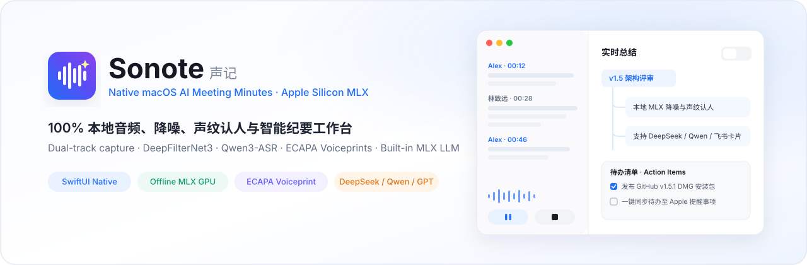
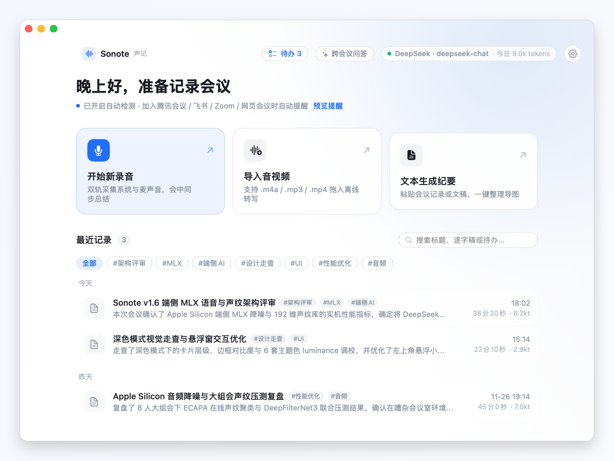
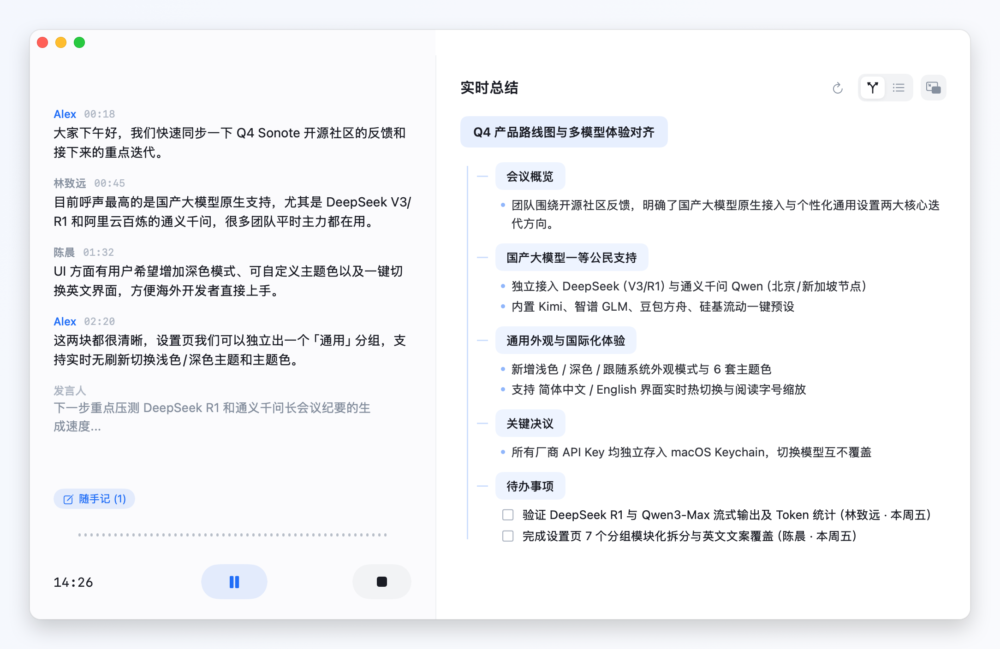
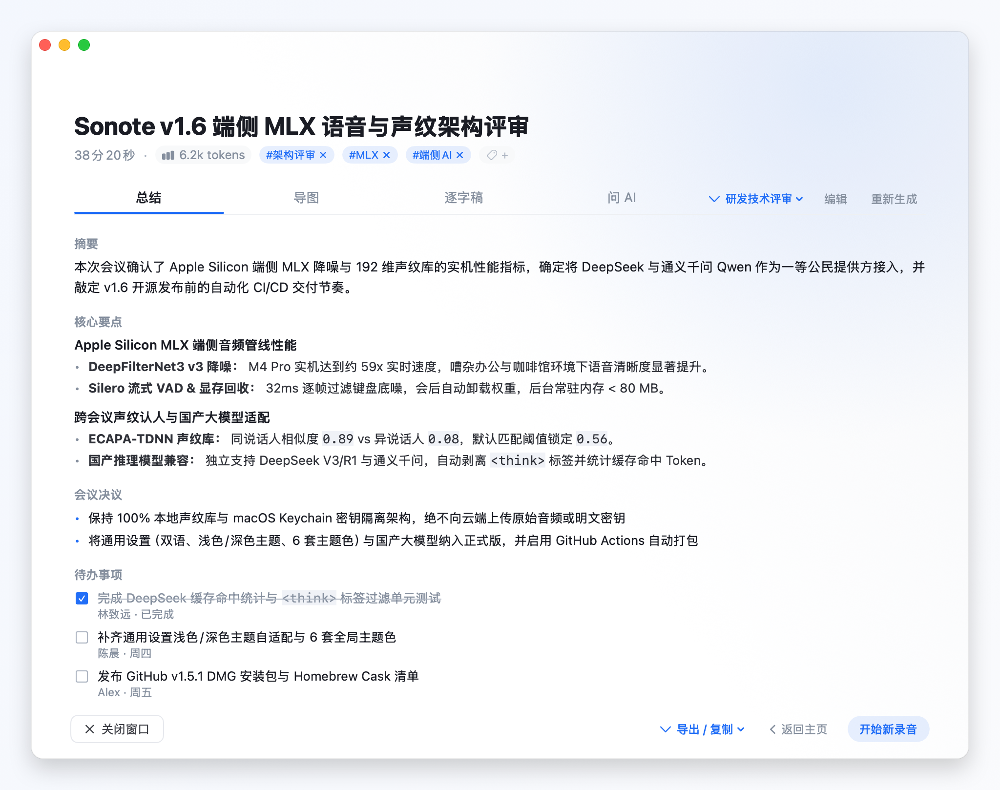
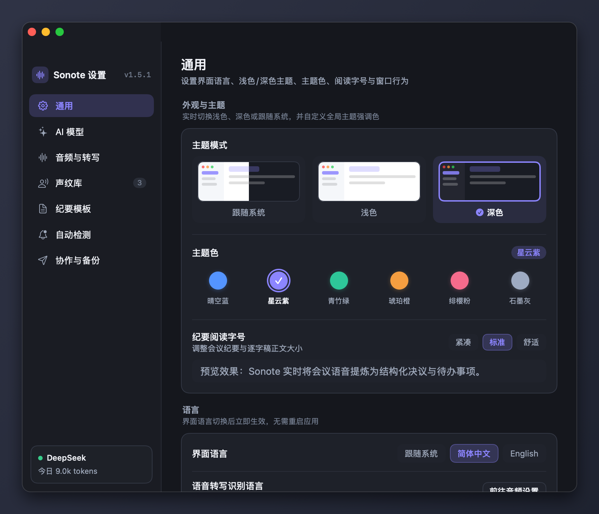
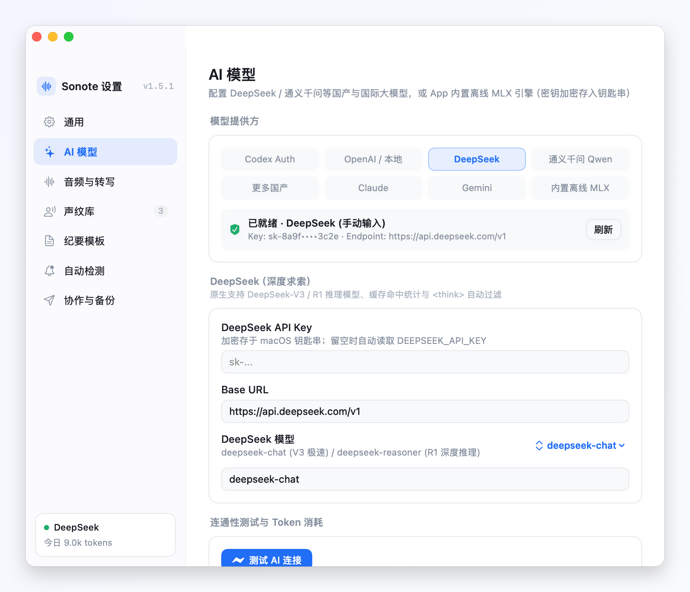
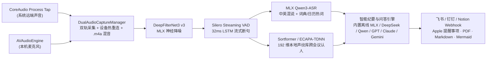

<p align="center">
  
</p>

<h1 align="center">Sonote（声记 / 智会纪要）</h1>

<p align="center">
  <strong>原生 macOS 智能会议纪要 App · 100% 本地 Apple Silicon MLX 语音、降噪、声纹与大模型引擎</strong>
</p>

<p align="center">
  <a href="./README_EN.md">English</a> · <strong>简体中文</strong> · <a href="./CHANGELOG.md">更新日志</a> · <a href="./CONTRIBUTING.md">参与贡献</a> · <a href="./SECURITY.md">隐私与安全</a>
</p>

<p align="center">
  <a href="https://github.com/eeachen4/Sonote/actions/workflows/ci.yml"></a>
  <a href="https://github.com/eeachen4/Sonote/releases"></a>
  
  
  
  
</p>

**Sonote（声记）** 是一款为 Apple Silicon Mac 打造的纯原生 SwiftUI 智能会议纪要工具（零 Electron、零 BlackHole 等虚拟声卡驱动、无需外部 Python/Ollama 进程）。

它在极简清新的浅色 / 深色自适配界面背后，集成了完整的本地 **Apple Silicon MLX** 语音与推理链路：**系统声音 + 麦克风双轨采集**、**DeepFilterNet3 神经降噪**、**Silero 流式 VAD**、**Qwen3-ASR 中英混说转写**、**Sortformer / ECAPA-TDNN 跨会议声纹认人**，以及**内置离线 Qwen2.5 MLX 大模型**与**国产/国际多模型（DeepSeek / 通义千问 Qwen / Kimi / 智谱 GLM / 豆包 / 硅基流动 / OpenAI / Claude / Gemini / Codex / Ollama）**，一键生成结构化会议纪要并推送至飞书、钉钉、Notion 与 Apple 提醒事项。

---

## 界面预览

### 极简主页工作台
自动检测会议软件状态、一键开始双轨录音 / 拖拽导入音视频 / 文本生成纪要，支持全局待办与跨会议 AI 问答。

<p align="center">
  
</p>

### 双栏实时转写与思维导图提炼
左侧实时呈现双轨说话人分离逐字稿与「会中随手记」，右侧动态提炼结构化思维导图、决议与待办。

<p align="center">
  
</p>

### 会后结构化纪要与待办清单
中文友好原生 Markdown 排版、按模板重生成、交互式待办勾选（支持一键同步 Apple 提醒事项），以及多渠道导出与 Webhook 推送。

<p align="center">
  
</p>

### 深色主题与国产 / 离线多模型设置

<table>
  <tr>
    <td width="50%" align="center">
      <br />
      <sub><strong>通用设置（深色模式）</strong> · 浅色/深色/跟随系统、6 套主题色、双语热切换与字号缩放</sub>
    </td>
    <td width="50%" align="center">
      <br />
      <sub><strong>AI 模型设置</strong> · DeepSeek / 通义千问 / 更多国产预设与内置离线 MLX 引擎</sub>
    </td>
  </tr>
</table>

---

## 快速下载与安装

### 方式一：直接下载预编译 DMG（推荐）
前往 [GitHub Releases](https://github.com/eeachen4/Sonote/releases) 下载最新的 `Sonote-*-arm64.dmg`，拖入「应用程序（`/Applications`）」即可使用。

> **首次打开提示「已损坏 / 无法验证开发者」？**
> 开源版本目前使用本地自签名分发，尚未接入 Apple Developer ID 公证。拖入 `/Applications` 后在终端执行一行命令解除隔离标记即可正常打开：
> ```bash
> xattr -cr /Applications/Sonote.app
> ```

### 方式二：Homebrew Cask（一行安装）
```bash
brew install --cask eeachen4/tap/sonote
```
（也支持从本仓库本地配方安装：`brew install --cask ./Casks/sonote.rb`）

---

## 本地音频与 AI 架构



---

## 核心特性

### 1. 无侵入会议自动检测与日历联动
- **CoreAudio 进程级自动感知**：实时监控会议软件音频状态（无需辅助功能或完整录屏权限），自动识别 **腾讯会议、飞书、钉钉、企业微信、微信、Zoom、Microsoft Teams、FaceTime、Slack、Discord、Webex** 及 **Chrome / Safari / Arc / Edge** 网页会议。
- **忽略应用黑名单**：支持在桌面提醒弹窗一键「不再提醒」，或在设置中管理自定义忽略列表。
- **macOS 日历联动（EventKit）**：开会时自动匹配当前日程标题，并将参会人姓名注入语音识别热词。
- **开机自启 & 系统级全局快捷键**：支持 `SMAppService` 静默驻留菜单栏，内置无需辅助功能权限的 Carbon 全局快捷键（默认 `⌥⇧R` 启停录音、`⌥⇧M` 呼出/收起窗口，全屏开会同样生效）。

### 2. 双轨采集、设备热插拔与音文同步回放
- **系统远端声音 + 麦克风双轨分离**：基于 `CoreAudio Process Tap`（仅需「仅系统音频录制」权限）+ `AVAudioEngine` 独立采集，自动区分本机与远端发言并过滤外放回声。
- **耳机热切换自动重连**：会中切换 AirPods、蓝牙耳机或外接麦克风时自动重建音频管线。
- **轻量化混音备份、波形拖拽与倍速回听**：录制自动保存 `.m4a` 并每 30 秒自动防崩溃检查点落盘（异常退出后重启可一键恢复）；会后支持 **88 柱真实音频波形进度条**（点击/拖拽定位 + 悬停时间预览）、`1x / 1.25x / 1.5x / 2x` 倍速、`±10s` 快进后退、空格键启停、**纪要要点 `[MM:SS]` 一键溯源跳转原声**、逐字稿关键词搜索高亮、双击修正错字并**自动提示加入热词词典**。
- **本地音视频离线导入与字幕导出**：拖拽或选择 `.m4a / .mp3 / .wav / .mp4 / .mov` 离线转写（视频自动提取轻量化音轨与波形），支持一键导出标准 **`.srt` / `.vtt` 字幕文件**。

### 3. 全链路 Apple Silicon MLX 语音、降噪与声纹引擎
- **MLX Qwen3-ASR**：默认 `mlx-community/Qwen3-ASR-1.7B-8bit`（可选 1.7B / 0.6B 4-bit / 8-bit，支持 `hf-mirror.com` 国内镜像），高精度中英混说；会后自动释放显存。
- **Silero 逐帧流式 VAD**：512 采样点（32 ms）LSTM 流式断句，兼顾轻声捕捉与抗键盘/环境底噪。
- **DeepFilterNet3 v3 嘈杂环境人声降噪**：内置 `MLXAudioSTS` 神经降噪（M4 Pro 实测约 59x 实时速度）。
- **Sortformer + ECAPA-TDNN 本地声纹库 & 跨会议自动认人**：192 维 ECAPA-TDNN 向量 100% 离线持久化，支持 5 秒录音/音频建档与改名一键「记住声纹」；提供 **Sortformer（≤4 人）** 与 **ECAPA 在线聚类（5~12 人大组会）**。
- 同步保留 **Apple 本机语音识别** 与 **OpenAI Audio Transcribe API** 作为备选。

### 4. 多模型提供方 & 国产大模型原生适配 & 内置离线引擎
所有 API 密钥与 Webhook 签名密钥均加密存储于 **macOS Keychain**，绝不落盘明文：
- **国产大模型原生支持**：
  - **DeepSeek（深度求索）**：独立配置 `deepseek-chat` (V3) / `deepseek-reasoner` (R1)，精准解析 `prompt_cache_hit_tokens` 缓存命中与思考 Token，并自动过滤 `<think>` 标签确保 JSON 纪要稳定输出。
  - **通义千问 Qwen（阿里云百炼 DashScope）**：支持北京/新加坡节点一键切换，内置 `qwen-plus` / `qwen-max` / `qwen-turbo` / `qwen3-max` / `qwq-plus` / `qwen-long`（超长会议神器）。
  - **更多国产平台一键预设**：内置 **Kimi（月之暗面）**、**智谱 GLM**、**豆包（火山方舟 Ark）**、**硅基流动（SiliconFlow）**、**MiniMax**、**腾讯混元** 预设地址与模型列表。
- **App 内置离线 MLX LLM**：直接基于 `MLXAudioCore.Qwen2Model` 在本机 Metal GPU 上流式运行量化 `Qwen2.5-Instruct`（`1.5B` / `3B` / `7B` 4-bit），**零外部 Ollama 进程、100% 离线、零 Token 费用**。
- **OpenAI / 本地服务 / Claude / Gemini / Codex Auth**：同时原生支持 OpenAI、本地 **Ollama / MLX Server**、Anthropic Claude、Google Gemini 与 `~/.codex/auth.json`。

### 5. 极简工作台、个性化外观、协作推送与数据迁移
- **通用设置（实时热切换）**：支持 **浅色 / 深色 / 跟随系统** 外观主题、**6 套全局主题色**（晴空蓝 / 星云紫 / 青竹绿 / 琥珀橙 / 绯樱粉 / 石墨灰）、**简体中文 / English** 实时切换、阅读字号缩放与内置 GitHub 版本更新检查。
- **悬浮录制胶囊、桌面双语实时字幕条 & 随手记**：录制中自动收起为 `316×108` 悬浮胶囊，单击即可一键展开双栏实时视图与「会中随手记」；支持一键开启可拖拽的桌面底部 **半透明实时字幕条**（含可选 AI 实时双语同传翻译）。
- **文档流式结构化纪要编辑**：支持多行自动换行输入、卡片化议题分组、全 5 大分区（摘要 / 核心要点 / 决议 / 待办 / 待确认问题）自由增删改，内置草稿快照撤销（`⌘⏎` 保存 / `Esc` 取消），保存后自动联动同步 Obsidian 笔记。
- **省 Token 增量提炼 & 超长会议 Map-Reduce**：会中增量发送新发言片段（省 60%–80% Token），超长会议自动两阶段分段汇总，按日精准统计 Token 账本。
- **自定义模板、会议置顶、批量管理、自定义问 AI 指令 & 跨会议问答**：内置 5 套模板 + 自定义 Prompt；支持重要会议置顶与主页多选批量打标签 / 导出 / 删除、自定义常用「问 AI」快捷指令、全局待办同步至 macOS「提醒事项」与多场会议交叉汇总。
- **中文友好原生 GFM Markdown 渲染**：自研行内解析器彻底解决中文标点紧邻加粗/斜体/代码时的渲染错位。
- **多渠道导出、Obsidian 自动同步 & 全库安全迁移**：支持 **Obsidian / Logseq 本地 Markdown 目录自动同步**（自动写入带 YAML Frontmatter 的 `.md` 笔记并按 `meeting_id` 原地更新）、飞书卡片 / 钉钉 Markdown / Notion・n8n Webhook（含 HMAC-SHA256 验签）、富文本复制、分页 A4 PDF、Mermaid 导图，以及 `.zip` 全库无损备份恢复。
- **3 步首次使用体检 & 高速元数据索引**：首次打开内置轻量引导卡片（音频权限 / 本地 MLX 预下载与国内镜像 / AI 模型速配）；底层采用 `meetings_index.json` 元数据索引，百场以上历史会议秒级检索。

---

## Apple Silicon 硬件与本地模型选型建议

| Mac 统一内存 | 推荐本地语音转写 (ASR) | 推荐纪要大模型 | 预计峰值内存占用 |
| :--- | :--- | :--- | :--- |
| **8 GB** | `Qwen3-ASR-0.6B-4bit`（~0.6 GB）或 Apple 本机识别 | 云端 API（DeepSeek / Qwen / GPT）或内置 `Qwen2.5-1.5B-4bit` | ~1.5 – 2.5 GB |
| **16 GB（推荐）** | `Qwen3-ASR-1.7B-4bit`（~1.4 GB）或 `1.7B-8bit`（~2.3 GB） | 云端 API 或内置 `Qwen2.5-3B-4bit`（~2.1 GB） | ~3.5 – 5.0 GB |
| **24 GB / 32 GB+** | `Qwen3-ASR-1.7B-8bit` + `DeepFilterNet3` + `ECAPA-TDNN` 全开 | 内置 `Qwen2.5-7B-4bit`（~4.5 GB）或任意云端旗舰模型 | ~6.0 – 8.0 GB |

> 开启「会后自动释放 MLX 显存与内存」后，非录制时段后台常驻内存仅约 **50–90 MB**。

---

## 从源码构建与测试

- **系统要求**：macOS 15.0 (Sequoia)+ · Apple Silicon (`arm64`) · Xcode 16+（含 `MetalToolchain`）

> 由于项目集成了 `mlx-swift` Metal GPU 着色器，请使用 `xcodebuild`（或提供的构建脚本）打包完整 `.app`，而非纯 `swift build`。

```bash
# 1. 克隆仓库
git clone https://github.com/eeachen4/Sonote.git
cd Sonote

# 2. 若首次编译提示缺少 Metal Toolchain，先安装一次
xcodebuild -downloadComponent MetalToolchain

# 3. 运行离线单元测试
xcodebuild test \
  -scheme Sonote-Package \
  -destination 'platform=macOS,arch=arm64' \
  -configuration Release

# 4. 构建并打包原生 macOS 应用 (dist/Sonote.app)
chmod +x scripts/build_app.sh scripts/install_app.sh scripts/package_dmg.sh
./scripts/build_app.sh

# 5. 一键安装到 /Applications/Sonote.app 并启动
./scripts/install_app.sh

# 6. 打包可分发的 .dmg 安装镜像
./scripts/package_dmg.sh
```

更多实机 MLX 集成测试与 PR 规范请查看 [CONTRIBUTING.md](./CONTRIBUTING.md)。

---

## 隐私与开源协议

- 所有会议纪要、录音与声纹向量仅保存在本机 `~/Library/Application Support/Sonote/`，密钥仅存于 macOS Keychain（`com.sonote.app`）；详见 [SECURITY.md](./SECURITY.md)。
- 本项目基于 [MIT License](./LICENSE) 开源。
