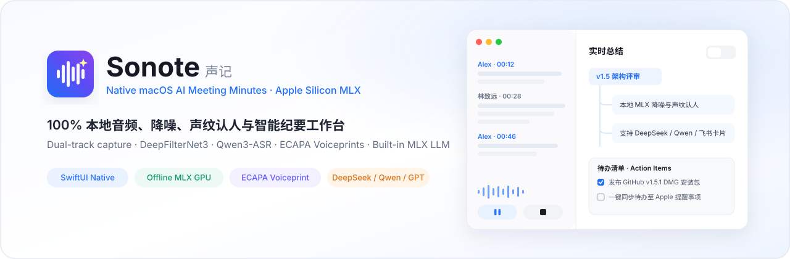
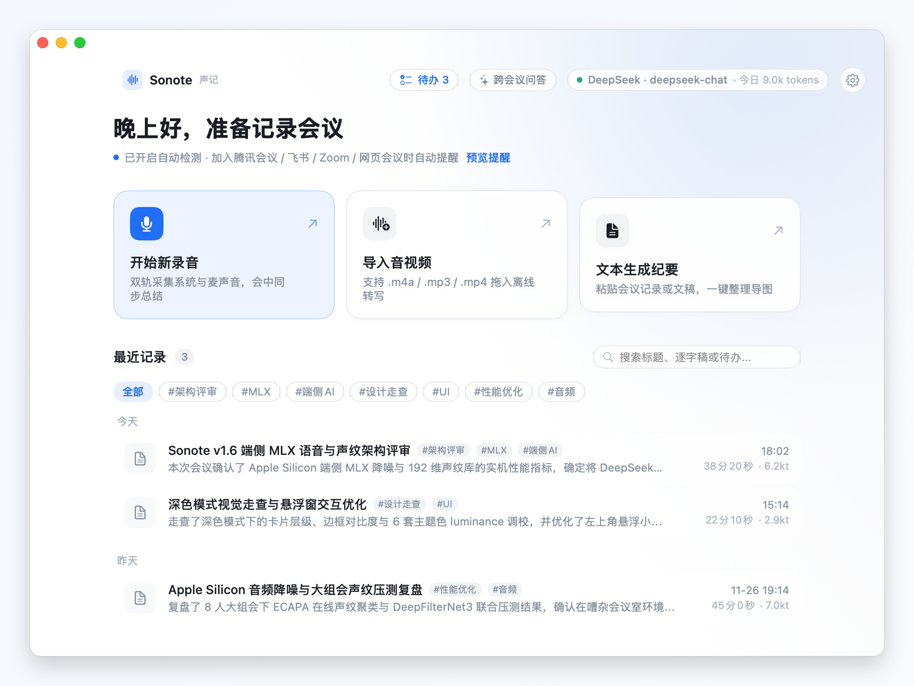
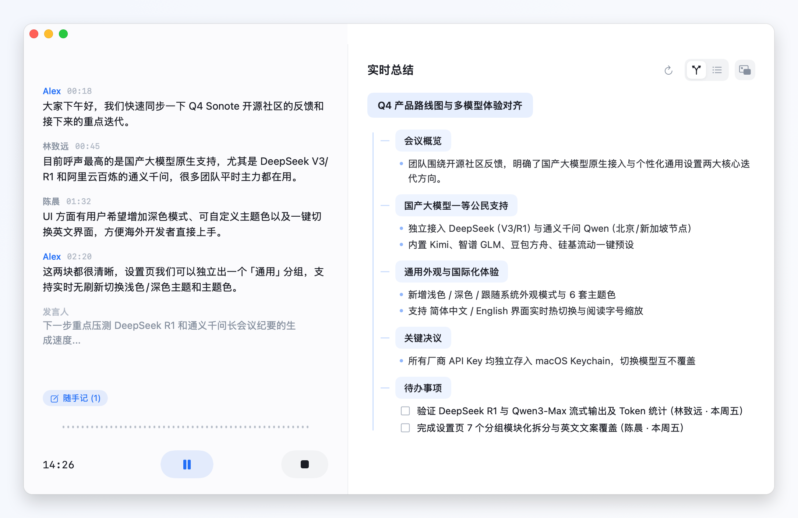
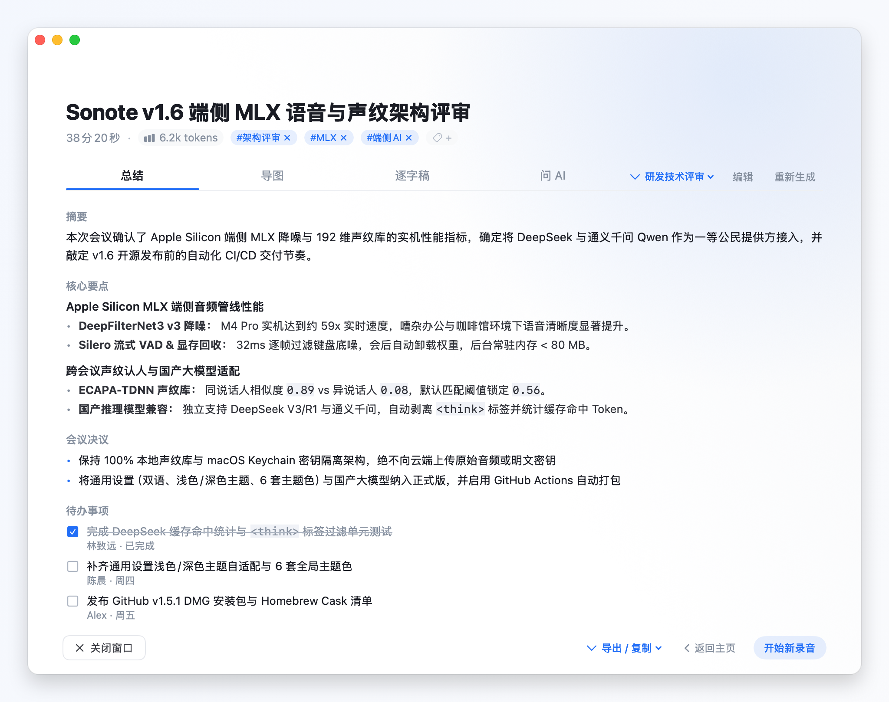
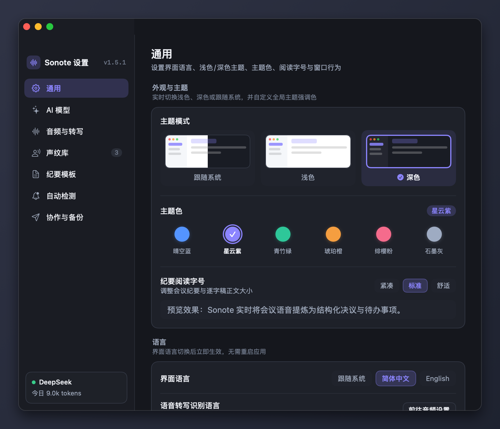
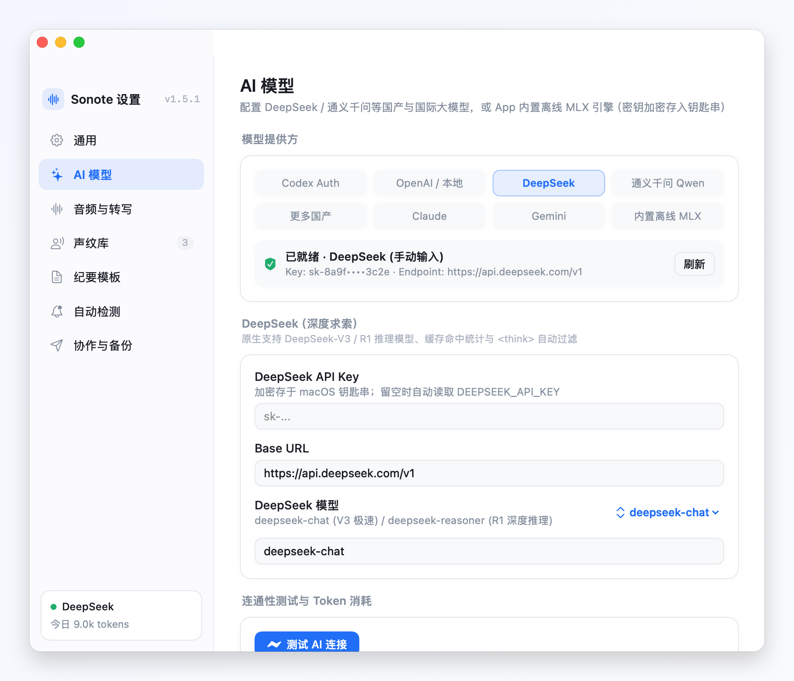
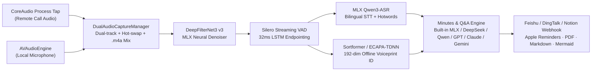

<p align="center">
  
</p>

<h1 align="center">Sonote (声记)</h1>

<p align="center">
  <strong>Native macOS AI Meeting Minutes powered 100% on-device by Apple Silicon MLX</strong>
</p>

<p align="center">
  <strong>English</strong> · <a href="./README.md">简体中文</a> · <a href="./CHANGELOG.md">Changelog</a> · <a href="./CONTRIBUTING.md">Contributing</a> · <a href="./SECURITY.md">Security</a>
</p>

<p align="center">
  <a href="https://github.com/eeachen4/Sonote/actions/workflows/ci.yml"></a>
  <a href="https://github.com/eeachen4/Sonote/releases"></a>
  
  
  
  
</p>

**Sonote** is a native SwiftUI meeting minutes app built for Apple Silicon Macs — no Electron, no virtual audio drivers (no BlackHole), and no external Python/Ollama server required.

Behind an adaptive Light/Dark minimalist UI with 6 customizable accent themes and live EN/ZH switching, Sonote runs an end-to-end on-device **MLX** audio & intelligence pipeline: **CoreAudio system audio + mic dual capture**, **DeepFilterNet3 neural denoising**, **streaming Silero VAD**, **Qwen3-ASR bilingual transcription**, **Sortformer & ECAPA-TDNN cross-meeting voiceprint recognition**, and a **built-in quantized Qwen2.5 MLX LLM** alongside cloud providers (**DeepSeek, Alibaba Qwen, Kimi, Zhipu GLM, Doubao, SiliconFlow, OpenAI, Claude, Gemini, Ollama, Codex**).

---

## Screenshots

### Minimalist Home Workspace
Live meeting auto-detection status, one-click dual-track recording, offline audio/video drag-and-drop import, global action items, and cross-meeting AI Q&A.

<p align="center">
  
</p>

### Live 2-Column Recording & Real-Time Mind-Map
Left pane displays speaker-labeled dual-track transcripts and collapsible live notes; right pane continuously synthesizes a structured mind-map, decisions, and action items.

<p align="center">
  
</p>

### Post-Meeting Smart Minutes & Action Items
Clean native Markdown typography, template re-generation, interactive checkboxes with Apple Reminders sync, and one-click Webhook / PDF / Markdown export.

<p align="center">
  
</p>

### Adaptive Dark Mode & Multi-Provider AI Settings

<table>
  <tr>
    <td width="50%" align="center">
      <br />
      <sub><strong>General Settings (Dark Mode)</strong> · Light/Dark/Auto appearance, 6 accents, live EN/ZH switch & font scale</sub>
    </td>
    <td width="50%" align="center">
      <br />
      <sub><strong>AI Models</strong> · First-class DeepSeek, Qwen, OpenAI, Claude, Gemini & built-in offline MLX LLM</sub>
    </td>
  </tr>
</table>

---

## Download & Install

### Option 1: Prebuilt DMG (Recommended)
Download the latest `Sonote-*-arm64.dmg` from [GitHub Releases](https://github.com/eeachen4/Sonote/releases) and drag **Sonote.app** to `/Applications`.

> **First-launch Gatekeeper note:** Open-source builds are currently self-signed (not notarized with a paid Apple Developer ID). If macOS reports the app cannot be opened, run once after copying to `/Applications`:
> ```bash
> xattr -cr /Applications/Sonote.app
> ```

### Option 2: Homebrew Cask
```bash
brew install --cask ./Casks/sonote.rb
```

---

## On-Device Pipeline Architecture



---

## Highlights

- **Zero-Friction Meeting Detection & Calendar Sync**: Detects active calls across Zoom, Teams, Feishu, DingTalk, Tencent Meeting, WeCom, Slack, Discord, Webex, FaceTime, and browser calls via CoreAudio (no Accessibility or full Screen Recording permission needed). Pulls meeting titles & attendee names from macOS Calendar (EventKit).
- **Dual-Track Capture & Synced Playback**: Captures system audio via macOS 15 `CoreAudio Process Tap` + microphone via `AVAudioEngine`, handles AirPods/headset hot-swapping, saves lightweight `.m4a` audio, and supports variable-speed playback (`1x`–`2x`) synced to transcript timestamps.
- **Full On-Device Apple Silicon MLX Audio Stack**:
  - **Qwen3-ASR (`mlx-audio-swift`)**: High-accuracy bilingual Chinese/English transcription with team glossary & calendar hotwords; auto-unloads GPU memory after meetings.
  - **Streaming Silero VAD**: 512-sample (32 ms) frame-by-frame LSTM endpointing.
  - **DeepFilterNet3 v3 Denoiser**: Neural speech enhancement (~59x real-time on M4 Pro) for noisy offices and cafés.
  - **Local ECAPA-TDNN Voiceprint Library & Diarization**: 192-dim speaker embeddings persisted 100% offline. Supports **Sortformer** (≤4 speakers) and **ECAPA online clustering** (5–12+ speakers) to identify real names across meetings.
- **Built-In Offline MLX LLM + Global & Chinese Cloud LLMs**:
  - Run quantized `Qwen2.5-Instruct` (`1.5B` / `3B` / `7B` 4-bit) directly inside the app via Metal GPU with zero external servers or token fees.
  - First-class support for **DeepSeek** (`deepseek-chat` / `deepseek-reasoner` with `prompt_cache_hit_tokens` & `<think>` handling), **Alibaba Qwen / DashScope** (Beijing & Singapore endpoints, `qwen-plus` / `qwen-max` / `qwen3-max` / `qwen-long`), and one-click presets for **Kimi**, **Zhipu GLM**, **Doubao Ark**, **SiliconFlow**, **MiniMax**, and **Tencent Hunyuan**.
  - Also supports **OpenAI / Ollama / MLX Server**, **Anthropic Claude**, **Google Gemini**, and local **Codex Auth** — all secrets stored in macOS Keychain.
- **Minimalist Craft, Adaptive Theme & Team Workflows**:
  - Live **Light / Dark / Auto** appearance, **6 accent colors**, live **English / 简体中文** interface toggle, reading font scale, and built-in GitHub release update checker.
  - Compact floating recording capsule (`316×108`) with first-click expand, collapsible live manual notes, custom templates, tags, **Apple Reminders** sync, **Cross-Meeting AI Q&A**, **Feishu / DingTalk / Custom JSON Webhooks** (HMAC-SHA256 signed), paginated A4 PDF export, and `.zip` full-library backup & merge restore.

---

## Apple Silicon RAM & Model Guide

| Unified Memory | Recommended Local ASR | Recommended Summary LLM | Peak Model Footprint |
| :--- | :--- | :--- | :--- |
| **8 GB** | `Qwen3-ASR-0.6B-4bit` (~0.6 GB) or Apple Speech | Cloud API (DeepSeek / Qwen / GPT) or built-in `Qwen2.5-1.5B-4bit` | ~1.5 – 2.5 GB |
| **16 GB (Recommended)** | `Qwen3-ASR-1.7B-4bit` (~1.4 GB) or `1.7B-8bit` (~2.3 GB) | Cloud API or built-in `Qwen2.5-3B-4bit` (~2.1 GB) | ~3.5 – 5.0 GB |
| **24 GB / 32 GB+** | `Qwen3-ASR-1.7B-8bit` + `DeepFilterNet3` + `ECAPA-TDNN` | Built-in `Qwen2.5-7B-4bit` (~4.5 GB) or any flagship cloud model | ~6.0 – 8.0 GB |

> With **Auto-Unload MLX Weights After Meeting** enabled, idle background memory stays around **50–90 MB**.

---

## Build from Source

- **Requirements**: macOS 15.0+ · Apple Silicon (`arm64`) · Xcode 16+ with `MetalToolchain`

```bash
git clone https://github.com/eeachen4/Sonote.git
cd Sonote

xcodebuild -downloadComponent MetalToolchain

# Run offline unit tests
xcodebuild test \
  -scheme Sonote-Package \
  -destination 'platform=macOS,arch=arm64' \
  -configuration Release

# Build signed native app bundle & package DMG
chmod +x scripts/build_app.sh scripts/install_app.sh scripts/package_dmg.sh
./scripts/build_app.sh
./scripts/install_app.sh
./scripts/package_dmg.sh
```

See [CONTRIBUTING.md](./CONTRIBUTING.md) for opt-in live hardware tests and PR guidelines.

---

## Privacy & License

- All local data stays in `~/Library/Application Support/Sonote/`; secrets stay in macOS Keychain (`com.sonote.app`). See [SECURITY.md](./SECURITY.md).
- Released under the [MIT License](./LICENSE).
